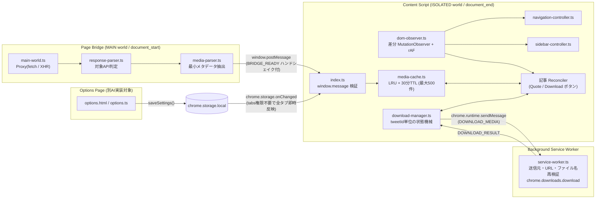

# YosoiX アーキテクチャ設計書・引き継ぎガイド

本書は [`spec.md`](./spec.md) をベースに、技術難度・破綻リスクの高いコア領域の設計と実装仕様をまとめたドキュメントです。  
あわせて、**実装済みのコア領域（変更禁止の不変条件）** と **別のAIに引き継ぐ残タスク（軽量UI・アイコン・テスト拡充）** の境界を明確に定義します。

---

## 1. 全体アーキテクチャと実行境界

Manifest V3 の4つの実行環境を疎結合に分離し、各境界に厳格なバリデーション層を設けています。



### 1.1 ビルド構成上の重要設計（MV3 チャンク分割問題の回避）
- Manifest V3 の `content_scripts`（`MAIN` / `ISOLATED`）は ES Modules の静的 `import` チャンク分割に対応していません。
- [`scripts/build.mjs`](./scripts/build.mjs) では `esbuild` により **4エントリーそれぞれを完全に独立した単一 IIFE バンドル**（`dist/main-world.js`, `dist/content.js`, `dist/service-worker.js`, `dist/options.js`）として出力します。
- パッケージマネージャーは **pnpm 専用**（`npm` / `yarn` / `bun` 使用禁止）です。

---

## 2. コア領域で解決済みの技術的難所と設計判断

### 2.1 MAIN ↔ ISOLATED 通信と初期ロード時の取りこぼし防止
- **X の通信特性への対応**: X Web クライアントは GraphQL API 通信の大部分を `fetch` ではなく **`XMLHttpRequest`** で送信します。[`src/bridge/main-world.ts`](./src/bridge/main-world.ts) では両方をフックしています。
  - `fetch`: `new Proxy` でラップし、元の `Promise<Response>` を一切遅延させずにそのまま返却しつつ、別ブランチで `response.clone().text()` を解析します。
  - `XMLHttpRequest`: クラス置換（`instanceof` 破壊の原因）を避け、`WeakMap<XMLHttpRequest, ...>` と `{ once: true, passive: true }` の `load` リスナーのみで非侵襲に読み取ります。
- **`document_start` 〜 `document_end` 間のレースコンディション対策**:
  - `main-world.js`（`document_start`）が初期タイムライン通信を捕捉した時点で、`content.js`（`document_end`）がまだ起動していない場合があります。
  - Content Script 起動時に `BRIDGE_READY` ハンドシェイクを送るまで、MAIN world 側で最大200件のリングバッファに保持し、準備完了と同時にフラッシュする設計としています。
- **クロスワールド信頼境界**:
  - Blink の `CustomEvent.detail` は異なる `DOMWrapperWorld` 間で `null` 化されるため、構造化クローンが保証される `window.postMessage` を採用しています。
  - MAIN world はページ側 JS と実行環境を共有するため信頼境界外とみなし、[`src/core/validators.ts`](./src/core/validators.ts) の `validateBridgeEnvelope()` で `event.source === window`・`event.origin`・スキーマ・配列長・CDN ホスト（`pbs.twimg.com` / `video.twimg.com` / `ton.twimg.com` の HTTPS 限定）を厳格に検証・無害化しています。

### 2.2 X GraphQL レスポンス解析と「引用・リポスト・カード」の厳密分離
[`src/core/media-parser.ts`](./src/core/media-parser.ts) にて以下の X 固有構造に対応済みです。
1. **ポリモーフィックな Tweet ラッパー**: `TweetWithVisibilityResults`（制限付き表示ラッパー）の `.tweet` 透過展開、`TweetTombstone` / `TweetUnavailable` の除外。
2. **`screen_name` の新旧スキーマ両対応**: X の 2024–2026 スキーマ変更により `legacy.screen_name` が空になり `core.user_results.result.core.screen_name` に移動したエンドポイントと、従来スキーマ・`UserWithVisibilityResults` のすべてに対応。
3. **引用ツイート（Quote）の混入防止**:
   - 各 Tweet ノードからは自身の `legacy.extended_entities.media`（補助: `legacy.entities.media`）と別投稿由来でない項目（`source_status_id_str` チェック）のみを抽出します。
   - `quoted_status_result` は親の `tweetId` には一切混ぜず、引用先自身の `tweetId` を持つ独立エントリとしてキャッシュします。これにより「引用先にだけ画像がある投稿」では親の `media` が `[]` と確定し、誤表示・誤取得を防ぎます。
4. **リポスト（Retweet）の元投稿解決**:
   - `retweeted_status_result` を持つラッパー投稿は登録をスキップし、内側の元ツイート自身の `rest_id` と元作者の `screen_name` で登録します（DOM 上の `<time>` パーマリンクも元ツイート ID を指すため完全に一致します）。
5. **リンクカード除外・利用不能メディア除外**:
   - リンクプレビュー（`tweet.card`）は参照しないため、OGP サムネイルを誤取得しません。
   - `ext_media_availability.status` 等が `"Available"` 以外の削除済み・DMCA メディアを除外します。
6. **原寸画像・最高品質動画・HLS 判定**:
   - 画像: `pbs.twimg.com` のコロンサフィックス（`:large` 等）を除去し、拡張子を維持したまま `name=orig` を付与します。
   - 動画 / GIF: `video/mp4` のうち最大 `bitrate` を選択します（GIF の `bitrate: 0` / `undefined` にも対応）。`.m3u8` しか存在しない場合は `HLS_ONLY` を返し、未対応である旨を明示します。

### 2.3 SPA・仮想スクロール対応 DOM 監視と引用枠境界判定
- **ポーリングゼロ・差分駆動監視（[`src/content/dom-observer.ts`](./src/content/dom-observer.ts)）**:
  - `header[role="banner"]`・`main[role="main"]`・`#layers`（「もっと見る」ポップアップメニュー用）の3領域にスコープを限定し、追加ノードのみを `requestAnimationFrame` でバッチ処理します。
  - 既存の `<article>` 内に遅れてアクションバーや画像がマウントされた場合も `closest('article[data-testid="tweet"]')` で該当記事のみを再評価します。
- **DOM 上での親ツイート vs 埋め込み引用ツイートの識別（[`src/content/tweet-dom.ts`](./src/content/tweet-dom.ts)）**:
  - X の埋め込み引用ツイートは `<article>` ではなく、2つ目の `[data-testid="User-Name"]` を内包する `div[role="link"]` / `div[tabindex]` として描画されます。
  - `isInsideEmbeddedQuoteOrCard()` により、通常タイムライン・リポスト・**ツイート詳細画面（Focal Tweet：`<time>` が引用カードの後ろに出現する構造）** のいずれでも、親ツイートの ID とアクションバーだけを正確に特定します。
- **React 18 イベント委譲との競合回避（[`src/content/index.ts`](./src/content/index.ts)）**:
  - React 18 は `#react-root` でイベントを捕捉するため、`document` のバブルフェーズでは `stopPropagation()` が間に合わずツイート詳細画面へ誤遷移します。
  - `document` の **`capture: true` フェーズ** で `[data-yosoix-action]` の `click` / `keydown(Enter, Space)` を処理することで、親 `<article>` への伝播を完全に遮断しています。
  - 引用一覧ボタンは本物の `<a href="/{user}/status/{id}/quotes">` として挿入し、通常左クリック時は `history.pushState` + `popstate` で高速 SPA 遷移（戻るボタンでスクロール位置維持）、Ctrl/中クリック時はブラウザー標準の別タブ遷移がそのまま機能します。
- **右サイドバー非表示と2ペイン画面保護（[`src/content/sidebar-controller.ts`](./src/content/sidebar-controller.ts) + [`src/styles/content.css`](./src/styles/content.css)）**:
  - `main[role="main"]` 内に右サイドバー（`sidebarColumn` 等）が存在する画面でのみ `primaryColumn` の `max-width: 600px` 制約を解除し、DM（`/messages`）や設定（`/settings`）の2ペイン画面やモーダル内 `aside`、狭いモバイル幅画面を破壊しません。

### 2.4 仮想スクロール再描画に耐えるダウンロード状態管理と SW 二重検証
- X のタイムラインは上下スクロールで `<article>` DOM が破棄・再生成されます。[`src/core/download-manager.ts`](./src/core/download-manager.ts) が `tweetId` キーで状態（`idle | loading | success | error`）を保持するため、ダウンロード処理中にスクロールしてもスピナーや完了表示が消えず、連打による重複起動も確実に防止します。
- [`src/background/service-worker.ts`](./src/background/service-worker.ts) では送信元オリジン・HTTPS・CDN ホスト・相対ファイル名（`XMedia/...` 固定、パストラバーサル `..` や Windows 予約語 `CON`/`NUL` 等の拒否）を再検証した上で `chrome.downloads.download({ conflictAction: "uniquify" })` を順次実行します。

---

## 3. ディレクトリ構成と実装ステータス一覧

| パス | 状態 | 担当・備考 |
|---|---|---|
| `manifest.json`, `package.json`, `tsconfig.json`, `vitest.config.ts`, `scripts/build.mjs` | **実装済** | MV3 4バンドル構成（変更不要） |
| `src/core/types.ts` | **実装済** | 全境界の型定義・定数（**契約変更禁止**） |
| `src/core/nav-items.ts` | **実装済** | 左ナビ13項目の定義テーブル＆リンク判定関数 |
| `src/core/validators.ts` | **実装済** | ブリッジ・SW・設定の境界バリデーター |
| `src/core/filename.ts` | **実装済** | `XMedia/{screen_name}_{tweet_id}_{連番}.{拡張子}` 生成 |
| `src/core/media-parser.ts` | **実装済** | GraphQL 走査・引用分離・原寸画像・MP4選択 |
| `src/core/media-cache.ts` | **実装済** | O(1) LRU + 30分TTL キャッシュ |
| `src/core/download-manager.ts` | **実装済** | DL状態機械・混在投稿の部分失敗継続制御 |
| `src/storage/settings.ts` | **実装済** | `chrome.storage.local` 読み書き＆即時同期購読 |
| `src/bridge/response-parser.ts`, `src/bridge/main-world.ts` | **実装済** | MAIN world 通信捕捉＆初期バッファ同期 |
| `src/content/*` (`index.ts`, `dom-observer.ts`, `tweet-dom.ts`, `navigation-controller.ts`, `sidebar-controller.ts`, `quote-list-button.ts`, `media-download-button.ts`) | **実装済** | ISOLATED world DOM 監視・UI注入制御 |
| `src/background/service-worker.ts` | **実装済** | Downloads API 実行・検証・アイコンクリック起動 |
| `src/styles/content.css` | **基本実装済** | レイアウト制御＋ボタン基本見た目（※微調整可） |
| `src/options/index.html`, `src/options/options.css`, `src/options/options.ts` | **実装済** | 1ページ完結・ライト/ダーク両対応カードUI |
| `public/icons/icon16.png`, `icon32.png`, `icon48.png`, `icon128.png` | **実装済** | オリジナル高精細アンチエイリアスPNG |
| `tests/*.test.ts` | **実装済** | 全5テストファイル・45件の全網羅テストパス |

---

## 4. 別のAIへの引き継ぎ実装指示（残タスク詳細）

別のAIは以下のルールとタスク仕様に従って残りの実装を完了させてください。

### 4.0 厳守ルール（ガードレール）
1. **パッケージマネージャー**: **必ず `pnpm` のみを使用すること**（`npm`, `yarn`, `bun` は禁止）。外部 UI フレームワーク（React 等）は追加せず、標準 DOM API + TypeScript で実装すること。
2. **コア契約の維持**: `src/core/types.ts` の型名・メッセージ形式、`manifest.json` の最小権限（`storage`, `downloads` のみ）を変更しないこと。
3. **ライセンス遵守**: 既存拡張機能（Control Panel for Twitter / Media Harvest）のコード・画像・アイコンをコピーせず、独自に作成すること。

---

### タスク1：設定画面（Options UI）の本実装
対象ファイル：
- [`src/options/index.html`](./src/options/index.html)
- [`src/options/options.css`](./src/options/options.css)
- [`src/options/options.ts`](./src/options/options.ts)

#### 実装要件（`spec.md` 2.2, 2.7, 3.1）
1. **1ページ完結の日本語UI**（タブ分割や不要な高度設定は作らない）。ライト／ダークモード（`prefers-color-scheme`）両対応のクリーンなカード型レイアウトにする。
2. **5つのセクション構成**:
   - **一般**: マスタースイッチ「拡張機能を有効にする」（`enabled: boolean`）。OFF のときは他セクションを視覚的にディム表示（または無効状態であることが分かる表示）にする。
   - **左ナビゲーション**: 非表示にする項目の個別チェックボックス一覧（`hiddenNavItems: NavItemId[]`）。
     - **重要**: 項目名ハードコードを避け、`src/core/nav-items.ts` の `NAV_ITEM_DEFINITIONS`（`id`, `label`, `description`）をループ描画すること（チェック ON ＝ 非表示にする項目として `hiddenNavItems` に追加）。
   - **右サイドバー**: スイッチ「右サイドバーを非表示にしてタイムラインを広げる」（`hideRightSidebar: boolean`）。
   - **ツイート**: スイッチ「各ツイートに引用リポスト一覧ボタンを表示する」（`showQuoteListButton: boolean`）。
   - **メディア**: スイッチ「画像・動画の一括ダウンロードボタンを表示する」（`enableMediaDownload: boolean`）。
   - フッター付近に「初期設定に戻す」ボタン（`resetSettings()` 呼び出し）と保存状態の控えめなトースト／ステータスメッセージ（`aria-live="polite"`）を設ける。
3. **保存・即時反映の接続方法**:
   - `src/storage/settings.ts` の `loadSettings()`, `saveSettings()`, `resetSettings()` をそのまま呼び出すだけで、`chrome.storage.onChanged` 経由で開いているすべての X タブに再読み込みなしで即時反映される。

---

### タスク2：拡張機能アイコンの作成とタイムラインUIの見た目確認
対象ファイル：
- `public/icons/icon16.png`, `public/icons/icon32.png`, `public/icons/icon48.png`, `public/icons/icon128.png`
- （必要に応じて微調整）[`src/styles/content.css`](./src/styles/content.css)

#### 実装要件
1. 現在は単色ブルーの最小プレースホルダー PNG が配置されているため、YosoiX 独自のシンプルで視認性の高いオリジナル PNG アイコン（16 / 32 / 48 / 128px）を生成・配置する。
2. `src/styles/content.css` について、X のライトモード／ダークモード（「ダークブルー」「ブラック」）の両方で `.yosoix-action-btn` の文字色・ホバー背景・フォーカスリングが自然に馴染むよう必要に応じて微調整する（ただしセクション1・2の `data-yosoix-*` セレクター構造は壊さないこと）。

---

### タスク3：ユニットテストスイートの網羅実装
対象ファイル（`spec.md` 4.8, 第6章）：
- `tests/media-parser.test.ts`
- `tests/filename.test.ts`
- `tests/navigation-controller.test.ts`
- `tests/quote-list-button.test.ts`

#### 必須テスト観点
1. **`tests/media-parser.test.ts`**:
   - 画像1枚、画像4枚、動画1本（複数ビットレート MP4 から最高ビットレート選択）、GIF（`animated_gif`, `bitrate: 0`）、**画像＋動画の混在投稿**。
   - `.m3u8`（HLS）のみの場合に `selectBestMp4Variant` が `{ ok: false, reason: "HLS_ONLY" }` を返すこと。
   - `pbs.twimg.com` の `.jpg` / `.png` / `?format=webp&name=small` / `:large` 付き URL がすべて `name=orig` かつ正しい拡張子に変換されること。
   - `TweetWithVisibilityResults` ラッパー、新旧 `screen_name` 位置、リポスト（元作者・元IDでの抽出）、引用ツイート（親と引用先のメディア分離）、リンクカード無視、`ext_media_availability` 非公開除外。
2. **`tests/filename.test.ts`**:
   - `XMedia/{screen_name}_{tweet_id}_{01}.{ext}` フォーマット、連番ゼロ埋め（`01`〜`04`）。
   - 禁止文字（`/\:*?"<>|`・制御文字）、Windows 予約語（`CON`, `NUL`, `COM1` 等）、空文字フォールバック、パストラバーサル拒否（`isSafeRelativeDownloadFilename`）。
3. **`tests/navigation-controller.test.ts`**:
   - `NAV_ITEM_DEFINITIONS` 全13項目の URL / `data-testid` マッチング（`/{user}/lists`, `/{user}/communities`, `ads.x.com` 含む）。
   - 常設 `<nav>` と `#layers [data-testid="Dropdown"]`（「もっと見る」メニュー）の両方で対象項目のみに `data-yosoix-nav-hidden` が付与され、ホーム・通知・投稿ボタン・`<nav>` 自体は絶対に非表示にならないこと。
   - マスター OFF や設定解除で `restoreAll()` が完全に元に戻すこと。
4. **`tests/quote-list-button.test.ts`**（および DOM ボタン冪等性）:
   - `quoteCount` あり（`引用 12`、0件時は `引用 0`）と `quoteCount` 未取得（`引用一覧`）の表示切り替え。
   - 同一アクションバーへの複数回 `upsertQuoteListButton` 呼び出しでボタンが重複しないこと、仮想スクロール再利用時に新しい `tweetId`・`href` へ更新されること。
   - 引用ツイート内部のリンクに対して外側と重複挿入しないこと。

---

## 5. ビルド・検証・Edge 読み込み手順

```powershell
# 型チェック
pnpm run typecheck

# テスト実行
pnpm test

# 本番ビルド（dist/ に出力）
pnpm run build

# 開発ウォッチビルド
pnpm run watch
```

### Microsoft Edge での動作確認手順
1. `pnpm run build` を実行し、`dist/` ディレクトリを生成する。
2. Microsoft Edge で `edge://extensions` を開き、左下の **「開発者モード」** を ON にする。
3. **「展開して読み込み」** をクリックし、`d:\dev\YosoiX\dist` フォルダーを選択する。
4. `https://x.com/` を開き、`spec.md` 第6章・第11章の完了条件に沿って動作を確認する。
